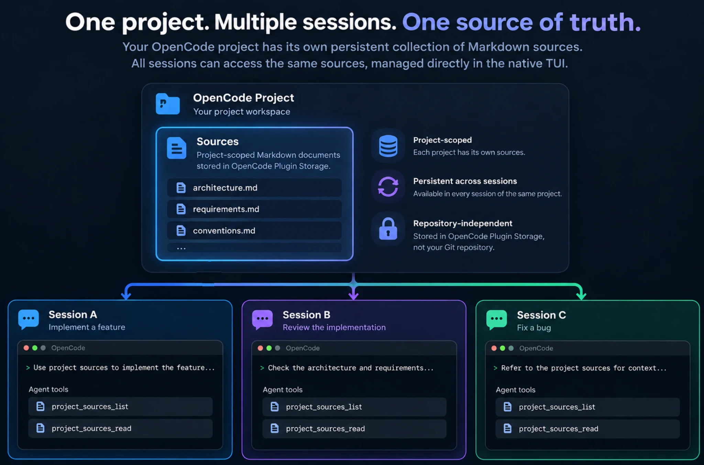
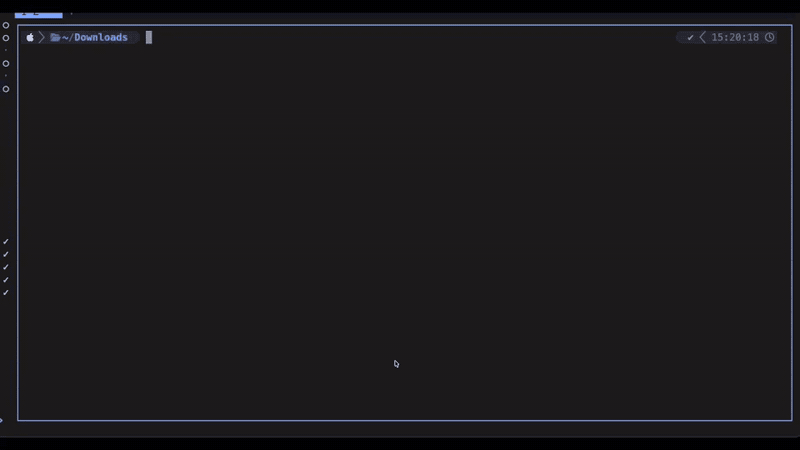

# SourcePier

[](https://www.npmjs.com/package/sourcepier)
[](LICENSE)


**One project. Multiple sessions. One source of truth.**

Project-scoped Markdown document management for **OpenCode v2**.

SourcePier gives each OpenCode project its own persistent collection of documents. Import, browse, edit, and manage Markdown directly in the native TUI. Sources stay available across sessions without living in your Git repository or being reattached to each conversation.

Agents can discover and read the same project documents using dedicated read-only tools.

## Overview



Keep documents such as architecture decisions, product requirements, and conventions with your project. Open a new session to implement a feature, review code, or fix a bug; the same Sources are available without importing them again.

## Features

- **Project-scoped** — independent Sources for each OpenCode project.
- **Persistent across sessions** — documents survive session changes and OpenCode restarts.
- **Native TUI** — manage Sources via `/sources`, with a searchable list, Markdown viewer, and editor.
- **Document lifecycle** — import, preview, edit, save, export, and delete Markdown.
- **Read-only agent tools** — agents can list and read Sources using dedicated tools.
- **Revision-aware saves** — detect competing edits instead of silently overwriting newer content.
- **Repository-independent** — documents are stored in OpenCode Plugin Storage, not committed to Git.

## Quick Start

### Requirements

- OpenCode v2.0.26 or higher

### Installation

Install SourcePier using OpenCode's native Plugin Manager:

```sh
opencode plugin add sourcepier
```

Verify the installation:

```sh
opencode plugin list
```

### Open Sources

Start OpenCode inside your project, then enter in the native TUI:

```text
/sources
```

Choose **+ Add / Import Markdown**, provide the path to an existing `.md` or `.markdown` file, and confirm the import. Or import directly:

```text
/sources add ./docs/architecture.md
```

The import copies a snapshot into the current project's Plugin Storage. Your original file is unchanged.

## Usage



| Action  | How                                                                              |
| ------- | -------------------------------------------------------------------------------- |
| Browse  | Enter `/sources` and search or select a Source.                                  |
| Import  | Choose **+ Add / Import Markdown**, or enter `/sources add <path>`.              |
| Preview | Select a Source for a scrollable, full-screen Markdown view.                     |
| Edit    | Press `e` while previewing a Markdown Source.                                    |
| Save    | Press `Ctrl+S` in the editor.                                                    |
| Export  | Press `x` in the viewer, then choose a **new** `.md` or `.markdown` output path. |
| Delete  | Press `d` in the viewer and confirm.                                             |

The viewer supports arrow keys, `j`/`k`, Page Up/Down, Home/End, and mouse-wheel scrolling. Press `Esc` to return to the list. Unsaved changes prompt for confirmation before discard; drafts can be retained across native TUI navigation or plugin reload.

**Import/export paths are resolved on the OpenCode server.** Relative paths are based on the current project directory, and `~/` refers to the server user's home directory. If your TUI connects to a remote server, the files must be accessible on that server.


## Agent Integration

SourcePier registers two agent tools:

| Tool                           | Purpose                                                    |
| ------------------------------ | ---------------------------------------------------------- |
| `project_sources_list`         | List available Sources for the invoking session's project. |
| `project_sources_read({ id })` | Read the latest contents of one Source in that project.    |

The plugin also adds a short **Source index** to the session context so the agent can discover relevant documents. It does **not** inject the full content of every Source: the agent reads a document when needed.

Document content is **reference data**, not instructions that override system rules or tool permissions. No import, edit, export, or delete capability is exposed through these two agent tools. The developer-facing write operations use OpenCode's normal RPC transport access control; they are not a separate authentication boundary.

## How It Works

1. A developer imports a Markdown document into the current OpenCode project. This stores a copy in OpenCode's durable Plugin Storage, leaving the original file intact.
2. Sessions belonging to that project share the same Source index. Sessions from other projects have separate Source collections.
3. A developer manages Sources from `/sources`; an agent lists and reads them through the dedicated tools.
4. Saves create new immutable content revisions and update the current revision pointer. Conflicting revisions or replaced Source instances are rejected rather than silently overwritten.

The canonical Sources are **not** a mirrored folder, a Git-backed document repository, or an automatically synchronized file collection.

## Limitations & Data Safety

- **Markdown import only:** `.md` and `.markdown` files containing valid UTF-8 text; a document may be up to **256 KiB**. The native editor supports Markdown Sources.
- **Bounded listing:** List responses show up to **100** Sources and indicate when more exist. This is a listing bound, not an enforced 100-document quota.
- **Snapshots, not sync:** editing the original file does not update its imported Source; editing a Source does not update the original file. Export is explicit.
- **No overwrite on export:** an existing destination file is not replaced. The existing Source ID cannot be replaced by re-importing a file with the same ID.
- **Delete is permanent:** deleting a Source removes its stored revisions. There is no Trash, Restore, or revision-history browser.
- **Local storage:** persistence follows OpenCode's Plugin Storage. There is no cross-device sync, automatic backup, or encryption guarantee supplied by this plugin. Do not use Sources as a secret store.
- **Write coordination:** updates use a local single-machine writer lock and revision checks. This does not provide distributed transactions across machines or protection from uncooperative writers sharing the same database.

## Development

SourcePier uses TypeScript, Bun, OpenTUI, and the OpenCode v2 Plugin API.

The Server Plugin ID and RPC ID are `sourcepier`; the native TUI Plugin ID is `sourcepier.tui`. The `/sources` command and the agent tool names remain unchanged. As a pre-release rename, this changes the internal Plugin Storage namespace: development-only data stored under the earlier `opencode-sources` Plugin ID is not automatically migrated.

```sh
npm ci --ignore-scripts
npm run typecheck
bun test tests/unit
npm run test:package
```

When the TUI source changes, rebuild and commit the distributed artifact:

```sh
npm run build:tui
npm run test:package
```

The `./tui` package export points to the built `dist/tui.js`. This is intentional: the OpenCode plugin manager must be able to load the installed package without transforming TSX from within `node_modules`. Keep `dist/tui.js` tracked in Git.

The `tests/runtime/` directory contains isolated OpenCode runtime verification harnesses. Development and runtime tests should use disposable projects and storage rather than production Sources.

## Contributing

The project is currently in pre-release. Contribution guidelines and a public issue/PR workflow will be finalized when the repository is opened to the public.

## License

SourcePier is licensed under the [MIT License](LICENSE).

This is an independent community plugin and is not affiliated with or endorsed by the OpenCode project.
